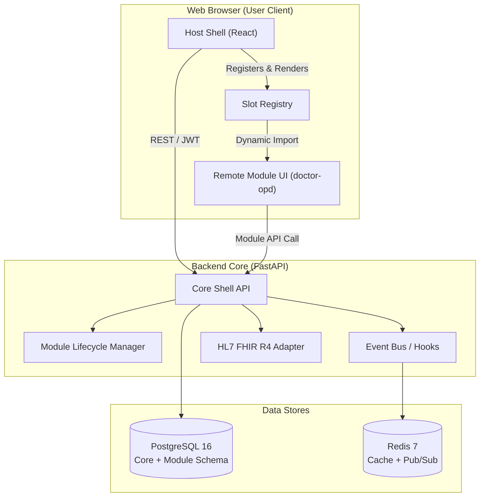

# 🏗️ System Overview (ภาพรวมสถาปัตยกรรมระบบ Organella)

ระบบ **Organella** ถูกออกแบบภายใต้แนวคิด **Generic Health Engine + Micro-Frontend & Backend Plugins** โดยมีวัตถุประสงค์เพื่อรองรับสถานพยาบาลทุกขนาด และเปิดโอกาสให้นักพัฒนาภายนอกสามารถสร้างส่วนขยายได้อิสระ

---

## 1. องค์ประกอบหลักของระบบ (Core Components)

### 1.1 Frontend Host Application (`apps/host-shell`)
- **เทคโนโลยี:** React, TypeScript, Vite, Tailwind CSS, Shadcn UI
- **หน้าที่หลัก:**
  - เป็น Shell คอยบริหารจัดการ Layout รวมของหน้าจอ เช่น Top Bar, Sidebar, Patient Search และ Active Patient Banner
  - จัดการ Global Context (User Session, Current Facility, Active Patient)
  - มี **Slot Registry Engine** สำหรับอ่าน Module Manifest และโหลด Remote Component จากโมดูลต่างๆ มาแสดงผลในตำแหน่งที่กำหนด (Extension Slots)

### 1.2 Backend Core API (`apps/core-api`)
- **เทคโนโลยี:** FastAPI, SQLAlchemy 2.0 (Async), Pydantic v2, PostgreSQL, Redis
- **หน้าที่หลัก:**
  - **Auth & RBAC:** ตรวจสอบตัวตนผู้ใช้และสิทธิ์การเข้าถึงข้อมูลตามบทบาท (แพทย์, พยาบาล, เภสัชกร, เวชระเบียน)
  - **Master Patient Index (MPI):** จัดเก็บข้อมูลประชากรศาสตร์และหมายเลขผู้ป่วย (HN, เลขประจำตัวประชาชน) เป็น Single Source of Truth
  - **Module Lifecycle Manager:** ตรวจสอบความถูกต้องของโมดูล (`module.json`), จัดการติดตั้ง, เปิด/ปิดการทำงาน และกระจาย Event Hooks
  - **Audit Logging:** บันทึกประวัติการเข้าถึงข้อมูลผู้ป่วยทุกจุดเพื่อความปลอดภัยตามมาตรฐาน PDPA และ HIPAA

### 1.3 Organella SDK (`packages/organella-sdk`)
- เป็นแพ็กเกจกลางที่ใช้ร่วมกันระหว่าง Host Shell และ Community Modules เพื่อกำหนดมาตรฐาน Contract:
  - นิยามประเภทข้อมูล Slot Props (`PatientTabProps`, `DashboardWidgetProps`)
  - ฟังก์ชันสื่อสารระหว่าง Host กับ Module (Event Dispatcher, Context Hook)
  - Data Validation Schema สำหรับ Module Manifest

### 1.4 Hybrid Healthcare Data Engine
- **Relational Tables:** ตารางฐานข้อมูล PostgreSQL สำหรับเก็บข้อมูลธุรกรรมที่ต้องการความเร็วและความคงเส้นคงวา (ACID)
- **HL7 FHIR R4 Adapter:** ชั้นแปลงและเชื่อมต่อข้อมูล (Interop Gateway) สำหรับแปลงข้อมูลคลินิกไปเป็น FHIR Resources (เช่น `Patient`, `Encounter`, `Condition`, `MedicationRequest`) เพื่อแลกเปลี่ยนกับระบบภายนอก

---

## 2. แผนภาพการไหลของข้อมูล (Data & Module Interaction Flow)

